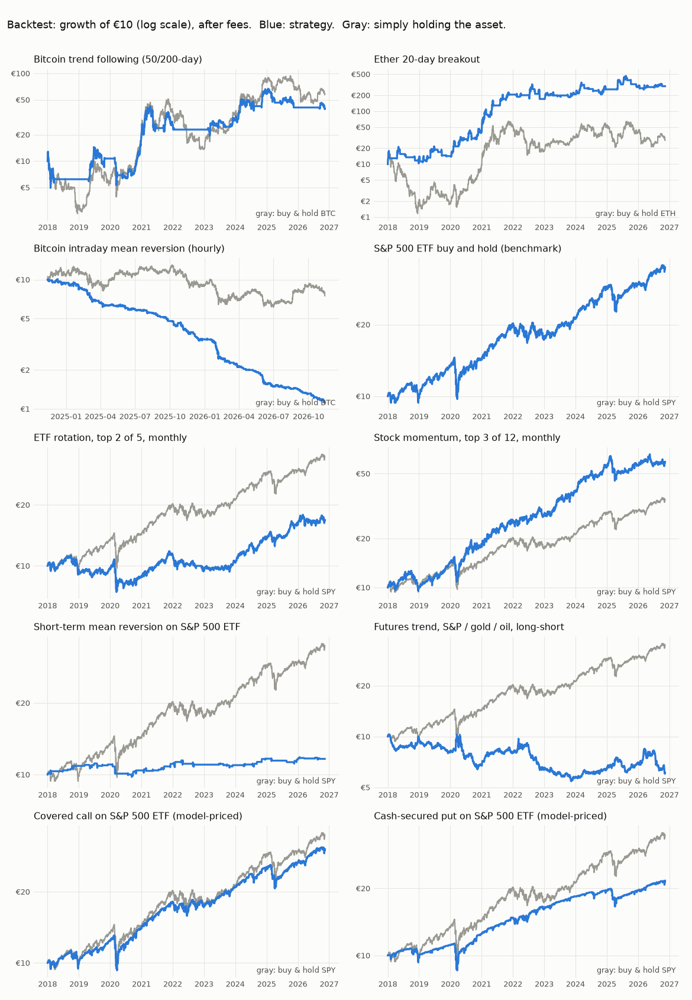

# Paper trading lab

**Simulated money only.** Ten rule-based strategies, each starting with an imaginary €10. No broker is connected and no real order is ever placed. This is an experiment, not investment advice.

_Last updated: 2026-11-13 04:31 UTC. Updated automatically by GitHub Actions._

## Live paper portfolio (record started 2026-11-13 03:54 UTC)

**Strategies: €100.00 → €99.97 (-0.0%)**  
**Just holding each benchmark: €100.00 → €99.81 (-0.2%)**

| # | Strategy | €10 is now | Hold instead | Holding now | Waiting order | Fills |
|---|---|---|---|---|---|---|
| 1 | Bitcoin trend following (50/200-day) | €10.00 (+0.0%) | €10.00 BTC | cash | yes | 0 |
| 2 | Ether 20-day breakout | €10.00 (+0.0%) | €10.00 ETH | cash | yes | 0 |
| 3 | Bitcoin intraday mean reversion (hourly) | €9.97 (-0.3%) | €9.81 BTC | BTC +100% |  | 1 |
| 4 | S&P 500 ETF buy and hold (benchmark) | €10.00 (+0.0%) | €10.00 SPY | cash | yes | 0 |
| 5 | ETF rotation, top 2 of 5, monthly | €10.00 (+0.0%) | €10.00 SPY | cash | yes | 0 |
| 6 | Stock momentum, top 3 of 12, monthly | €10.00 (+0.0%) | €10.00 SPY | cash | yes | 0 |
| 7 | Short-term mean reversion on S&P 500 ETF | €10.00 (+0.0%) | €10.00 SPY | cash | yes | 0 |
| 8 | Futures trend, S&P / gold / oil, long-short | €10.00 (+0.0%) | €10.00 SPY | cash | yes | 0 |
| 9 | Covered call on S&P 500 ETF (model-priced) | €10.00 (+0.0%) | €10.00 SPY | cash | yes | 0 |
| 10 | Cash-secured put on S&P 500 ETF (model-priced) | €10.00 (+0.0%) | €10.00 SPY | cash | yes | 0 |

Risk-adjusted comparison (Sharpe, worst drop) appears once 30 daily values are recorded (0 so far).

Each strategy started in cash. "Hold instead" is €10 put into that strategy's benchmark at the same moment. Judge a strategy by its number of fills and its result against that benchmark, not by elapsed time alone: a monthly rule produces about 12 decisions a year.

### Orders waiting to be filled

Recorded now, filled at the close of the next finished price bar.

| Order | Recorded (UTC) | Instruction |
|---|---|---|
| btc_trend-00001 | 2026-11-13 03:54 | BTC +100% |
| cash_secured_put-00001 | 2026-11-13 03:54 | sell 21-day put, 2% out of the money |
| covered_call-00001 | 2026-11-13 03:54 | sell 21-day call, 2% out of the money |
| etf_rotation-00001 | 2026-11-13 03:54 | EFA +50%, SPY +50% |
| eth_breakout-00001 | 2026-11-13 03:54 | all cash |
| futures_trend-00001 | 2026-11-13 03:54 | BZ +33%, ES +33%, GC -33% |
| spy_hold-00001 | 2026-11-13 03:54 | SPY +100% |
| spy_rsi2-00001 | 2026-11-13 03:54 | all cash |
| stock_momentum-00001 | 2026-11-13 03:54 | AAPL +33%, JNJ +33%, MSFT +33% |

### Latest fills

| Order | Bar closed (UTC) | Action | Asset | Price | Value | Fee |
|---|---|---|---|---|---|---|
| btc_intraday-00001 | 2026-11-13 04:00 | BUY | BTC | 62,282.3590 | €9.97 | €0.0299 |

## How the live record is kept honest

- **Orders are written down before they can be filled.** Each run first fills earlier orders at the close of the first price bar that finished *after* the order was recorded, then records new orders. The order is committed to git before the price it fills at exists. See `results/live/orders.csv` and `fills.csv`.
- **Nothing live is recomputed from history.** Positions and cash are carried forward in `results/live/state.json`. If a run is missed, the order simply fills later, as it would for a real bot that was down.
- **Rule version `a1ef7b38b459`.** Every order, fill and daily value carries this hash of the rule code and the git commit that produced it. If the rule code changes at all, the hash changes, the current record is moved untouched to `results/archive/` and a new record starts from €10. This is enforced by the code, not by a promise.
- **This record started from commit [`da814c3`](https://github.com/abhinav279garg/paper-trading-lab/commit/da814c3bc112db9c2695dbc6b29c245439dd2e6c).**
- **Fills use the bar's closing price** plus the percentage cost below. A real order would not get exactly that price; the cost figure is the allowance for it.

Earlier records, kept unchanged: `results/archive/2026-11-12_v1-recomputed`.

## Backtest: what these rules would have done in the past

This is history, not evidence that the rules will work. Fees are included. "Hold" is simply buying the benchmark and doing nothing over the same period.

| # | Strategy | Period | Total | Per year | Worst drop | Sharpe | Hold: total | Hold: worst drop | Hold: Sharpe | Trades | Fees per €10 |
|---|---|---|---|---|---|---|---|---|---|---|---|
| 1 | Bitcoin trend following (50/200-day) | 2018-01-01 → 2026-11-12 | +292.6% | +16.7% | -63.3% | 0.56 | +471.9% BTC | -80.4% | 0.63 | 18 | €1.35 |
| 2 | Ether 20-day breakout | 2018-01-01 → 2026-11-12 | +2865.7% | +46.6% | -51.5% | 0.99 | +183.7% ETH | -93.5% | 0.56 | 127 | €62.24 |
| 3 | Bitcoin intraday mean reversion (hourly) | 2024-11-13 → 2026-11-13 | -88.9% | -66.6% | -89.0% | -4.70 | -25.0% BTC | -52.6% | -0.11 | 707 | €9.59 |
| 4 | S&P 500 ETF buy and hold (benchmark) | 2018-01-02 → 2026-11-12 | +248.2% | +15.1% | -33.1% | 0.80 | +248.2% SPY | -33.1% | 0.80 | 0 | €0.00 |
| 5 | ETF rotation, top 2 of 5, monthly | 2018-01-02 → 2026-11-12 | +68.7% | +6.1% | -34.0% | 0.41 | +248.2% SPY | -33.1% | 0.80 | 228 | €0.49 |
| 6 | Stock momentum, top 3 of 12, monthly | 2018-01-02 → 2026-11-12 | +489.3% | +22.2% | -29.9% | 0.93 | +248.2% SPY | -33.1% | 0.80 | 398 | €2.05 |
| 7 | Short-term mean reversion on S&P 500 ETF | 2018-01-02 → 2026-11-12 | +16.4% | +1.7% | -12.2% | 0.31 | +248.2% SPY | -33.1% | 0.80 | 128 | €1.40 |
| 8 | Futures trend, S&P / gold / oil, long-short | 2018-01-02 → 2026-11-12 | -39.0% | -5.4% | -47.2% | -0.23 | +248.2% SPY | -33.1% | 0.80 | 1054 | €1.03 |
| 9 | Covered call on S&P 500 ETF (model-priced) | 2018-01-02 → 2026-11-12 | +203.2% | +13.3% | -28.8% | 0.85 | +248.2% SPY | -33.1% | 0.80 | 214 | €1.03 |
| 10 | Cash-secured put on S&P 500 ETF (model-priced) | 2018-01-02 → 2026-11-12 | +116.5% | +9.1% | -24.2% | 0.75 | +248.2% SPY | -33.1% | 0.80 | 214 | €1.11 |

### All 9 daily strategies together, equal money in each

| Portfolio | Per year | Worst drop | Volatility | Sharpe |
|---|---|---|---|---|
| The strategies | +21.4% | -34.4% | 26.3% | 0.87 |
| The strategies without Ether breakout | +11.9% | -24.6% | 15.9% | 0.79 |
| Each strategy's own benchmark, held | +15.4% | -41.2% | 26.3% | 0.68 |
| Everything in the S&P 500 ETF | +15.1% | -33.1% | 20.1% | 0.80 |

The combined result leans almost entirely on one strategy. Without Ether breakout the rest did not beat simply holding the S&P 500 ETF on a risk-adjusted basis.

### Consistency check: the same backtest in two halves

This is **not** an out-of-sample test: both halves were already known when the rules were written. It only shows whether a result came from one lucky stretch. The only real out-of-sample evidence is the live record above.

| # | Strategy | Before 2022: strategy | hold | From 2022: strategy | hold | Beat hold in both? |
|---|---|---|---|---|---|---|
| 1 | Bitcoin trend following (50/200-day) | +153.8% | +258.0% | +50.2% | +55.1% | no |
| 2 | Ether 20-day breakout | +1957.9% | +403.2% | +44.1% | -44.9% | yes |
| 3 | Bitcoin intraday mean reversion (hourly) | n/a | n/a | n/a | n/a | history too short |
| 4 | S&P 500 ETF buy and hold (benchmark) | +100.9% | +100.9% | +73.1% | +73.1% | is the benchmark |
| 5 | ETF rotation, top 2 of 5, monthly | +14.0% | +100.9% | +49.7% | +73.1% | no |
| 6 | Stock momentum, top 3 of 12, monthly | +156.4% | +100.9% | +129.1% | +73.1% | yes |
| 7 | Short-term mean reversion on S&P 500 ETF | +10.9% | +100.9% | +5.0% | +73.1% | no |
| 8 | Futures trend, S&P / gold / oil, long-short | -19.7% | +100.9% | -23.9% | +73.1% | no |
| 9 | Covered call on S&P 500 ETF (model-priced) | +81.6% | +100.9% | +66.9% | +73.1% | no |
| 10 | Cash-secured put on S&P 500 ETF (model-priced) | +47.9% | +100.9% | +46.4% | +73.1% | no |

## Read this before believing any number above

- **Past results do not predict future results.** A rule that worked in a backtest often stops working.
- **Stock momentum still has some bias.** Its universe is the 12 largest US companies at the end of 2017, so it does not pick from today's winners. But 12 giants that all survived is a small and favourable sample.
- **Options are model-priced.** There is no free historical options data, so strategies 9 and 10 use a pricing formula with the VIX index as volatility, a 5% spread haircut and a rough adjustment for calls. Real covered-call funds have lagged the index over this period.
- **Futures and options cannot be traded at €10.** One futures contract needs thousands of euros of margin and one option contract covers 100 shares. The simulation allows fractions to show how the rule behaves.
- **Day trading loses to fees.** The hourly Bitcoin rule trades hundreds of times, and each trade pays the fee. GitHub's scheduler can also run late, which delays its orders.
- **Real fees at this size would be worse.** Costs are a percentage (0.30% crypto, 0.10% stocks/ETFs, 0.05% futures per trade). A flat €1 broker fee on a €10 order is 10%.
- **Currency:** US assets are converted to euros with the daily EUR/USD rate.
- **No taxes, no interest on cash.**

## How it works

- `lab/strategies.py`: the ten rules. `lab/engine.py`: trade arithmetic and backtest. `lab/live.py`: the forward paper engine. `lab/run.py`: the scheduled job. `tests/`: checks, run before every update.
- A decision made on one bar's closing price is executed on a later bar's closing price.
- Prices come from Yahoo Finance via the `yfinance` library.
- Run the backtest yourself: `pip install -r requirements.txt && python -m lab.run --offline` (outside GitHub Actions this never touches the live record).
